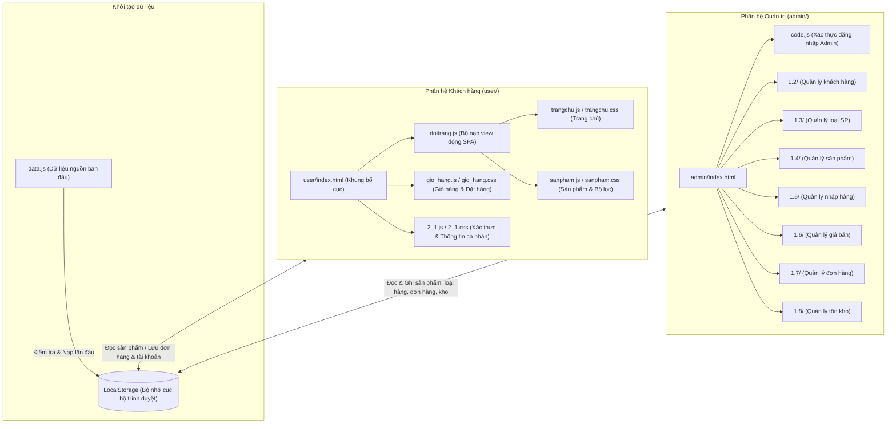

<div align="center">
  <h1>🛒 Website Thương Mại Điện Tử Điện Máy SGU</h1>
  <p><i>Hệ thống website mua sắm thiết bị điện máy và gia dụng trực tuyến phục vụ người tiêu dùng và hỗ trợ quản lý bán hàng cho người quản trị.</i></p>
  <p>
    
    
    
    
    
    
  </p>
</div>

<p align="center">
  <a href="#-giới-thiệu">Giới thiệu</a> •
  <a href="#-tính-năng-chính">Tính năng</a> •
  <a href="#️-kiến-trúc">Kiến trúc</a> •
  <a href="#️-công-nghệ">Công nghệ</a> •
  <a href="#-cấu-trúc-thư-mục">Cấu trúc</a> •
  <a href="#-cài-đặt-và-chạy">Cài đặt</a> •
  <a href="#-thành-viên-nhóm">Nhóm</a>
</p>

---

## 📋 Thông tin đồ án

| Mục | Nội dung |
|---|---|
| Trường | Trường Đại học Sài Gòn (SGU) |
| Môn học | Phân tích thiết kế hệ thống thông tin (Information Systems Analysis and Design - ISAD) |
| Học kỳ | HK1, năm học 2026-2027 |
| Giảng viên |  |
| Nhóm | Nguyễn Thành Long (Trưởng nhóm), Lê Trung Hùng, Lại Đình Nguyên, Trần Hữu Duy, Nguyễn Đức Hùng, Phạm Khánh Nguyên |

## 🎯 Giới thiệu

Dự án giải quyết nhu cầu tra cứu và đặt mua trực tuyến các thiết bị điện tử, điện gia dụng thông qua giao diện web trực quan. Mục tiêu của đồ án là hiện thực hóa quy trình mua bán hàng điện máy hoàn chỉnh, kết nối giữa trải nghiệm của khách hàng và hoạt động nghiệp vụ của người quản lý cửa hàng. Phạm vi đồ án gồm phân hệ bán hàng dành cho khách hàng (xem, lọc, tìm kiếm, giỏ hàng, đặt hàng) và phân hệ quản trị nội bộ (quản lý sản phẩm, loại hàng, khách hàng, đơn hàng, nhập kho, định giá và tồn kho) vận hành trên nền tảng web tĩnh kết hợp bộ nhớ trình duyệt.

## ✨ Tính năng chính

### Phân hệ khách hàng

| Tính năng | Mô tả |
|---|---|
| Danh mục ngành hàng | Hiển thị 5 nhóm ngành hàng điện máy gồm máy giặt, tủ lạnh, tivi, máy lạnh và máy lọc không khí. |
| Tìm kiếm sản phẩm | Tra cứu sản phẩm theo từ khóa tên thiết bị theo thời gian thực. |
| Bộ lọc kết hợp | Lọc đồng thời theo nhóm sản phẩm và các khoảng mức giá bán. |
| Phân trang tự động | Chia danh sách hiển thị cố định 12 sản phẩm trên mỗi trang danh mục. |
| Xem chi tiết sản phẩm | Hiển thị hộp thoại nổi thông số kỹ thuật, hình ảnh, giá niêm yết gốc và giá bán thực tế. |
| Giỏ hàng và đặt hàng | Thêm sản phẩm, tăng giảm số lượng, xóa mặt hàng và lưu hóa đơn mua sắm vào bộ nhớ trình duyệt. |
| Đăng ký và đăng nhập | Tạo tài khoản mới có kiểm tra dữ liệu đầu vào và lưu phiên làm việc của người dùng hiện tại. |
| Quản lý thông tin cá nhân | Xem và cập nhật họ tên, giới tính, email, số điện thoại cùng địa chỉ nhận hàng. |

### Phân hệ quản trị

| Tính năng | Mô tả |
|---|---|
| Đăng nhập quản trị | Bảo vệ trang quản trị bằng tài khoản quản trị viên cố định (`admin` / `123`). |
| Quản lý khách hàng (Module 1.2) | Hiển thị danh sách tài khoản người dùng, thông tin liên lạc và lịch sử đơn hàng. |
| Quản lý loại sản phẩm (Module 1.3) | Thêm, sửa thông tin, xóa và chuyển đổi trạng thái hiển thị của các loại mặt hàng. |
| Quản lý danh mục sản phẩm (Module 1.4) | Thao tác thêm, sửa, xóa, tìm kiếm và phân trang danh mục 50 sản phẩm. |
| Quản lý nhập hàng (Module 1.5) | Lập phiếu nhập kho từ nhà cung cấp và tự động cộng dồn số lượng tồn kho của sản phẩm. |
| Quản lý giá bán (Module 1.6) | Theo dõi giá vốn, điều chỉnh giá bán niêm yết và cập nhật giá bán mới của từng mặt hàng. |
| Quản lý đơn hàng (Module 1.7) | Tra cứu đơn đặt hàng, xem chi tiết mặt hàng trong đơn và cập nhật trạng thái xử lý đơn. |
| Quản lý số lượng tồn (Module 1.8) | Giám sát tồn kho thực tế, phân loại trạng thái hàng hóa và cảnh báo sản phẩm chạm ngưỡng tối thiểu. |

## 🏗️ Kiến trúc



Hệ thống hoạt động theo mô hình ứng dụng web một trang (Single Page Application - SPA) chạy hoàn toàn ở phía máy khách (Client-side) mà không sử dụng máy chủ backend riêng. Tệp `data.js` đóng vai trò tạo hạt giống dữ liệu ban đầu (Data Seeding), tự động kiểm tra và ghi dữ liệu mẫu vào `LocalStorage` (Bộ nhớ cục bộ trình duyệt) khi truy cập lần đầu. Cả hai phân hệ Khách hàng và Quản trị viên đều truy xuất, cập nhật và đồng bộ trạng thái thông qua `LocalStorage` để xử lý toàn bộ vòng đời của sản phẩm và đơn hàng.

## 🛠️ Công nghệ

| Thành phần | Công nghệ | Vai trò |
|---|---|---|
| Giao diện người dùng | HTML5, CSS3 | Xây dựng cấu trúc trang và định dạng giao diện tương thích (Responsive) |
| Ngôn ngữ xử lý | JavaScript (ES6+) | Điều hướng trang đơn (SPA), xử lý logic nghiệp vụ và tương tác DOM |
| Thư viện biểu tượng | Font Awesome 7.0.1 (CDN) | Cung cấp hệ thống biểu tượng trực quan trên các thanh điều hướng và nút chức năng |
| Lưu trữ dữ liệu | LocalStorage (Web Storage API) | Lưu trữ và mô phỏng cơ sở dữ liệu quan hệ phía máy khách |
| Nền tảng máy chủ đám mây | Vercel | Lưu trữ mã nguồn và cung cấp tên miền truy cập website trực tuyến |

## 📁 Cấu trúc thư mục

```text
Do_an/
├── admin/                      # Phân hệ quản trị viên (Admin Dashboard)
│   ├── 1.2/                    # Chức năng quản lý khách hàng
│   ├── 1.3/                    # Chức năng quản lý loại sản phẩm
│   ├── 1.4/                    # Chức năng quản lý danh mục sản phẩm
│   ├── 1.5/                    # Chức năng quản lý nhập hàng
│   ├── 1.6/                    # Chức năng quản lý giá bán
│   ├── 1.7/                    # Chức năng quản lý đơn hàng
│   ├── 1.8/                    # Chức năng quản lý số lượng tồn
│   ├── code.js                 # Xử lý đăng nhập, đăng xuất và điều hướng quản trị
│   ├── index.html              # Trang quản trị chính
│   └── style.css               # Định dạng giao diện chung trang quản trị
├── user/                       # Phân hệ khách hàng (Storefront)
│   ├── 2_1.css / 2_1.js        # Giao diện và xử lý đăng nhập, đăng ký, tài khoản
│   ├── doitrang.js             # Bộ nạp view động theo cơ chế Single Page Application
│   ├── gio_hang.css / .js      # Giao diện và xử lý giỏ hàng, tạo đơn hàng
│   ├── index.html              # Khung giao diện chính phía khách hàng
│   ├── sanpham.css / .js       # Giao diện và logic hiển thị, lọc, tìm kiếm sản phẩm
│   ├── style.css               # Định dạng giao diện người dùng
│   ├── trang.js                # Chứa khuôn mẫu HTML của các trang giao diện
│   └── trangchu.css / .js      # Giao diện và hiển thị sản phẩm trang chủ
├── img/                        # Thư mục chứa hình ảnh sản phẩm và logo SGU
├── data.js                     # Dữ liệu mẫu ban đầu để nạp vào LocalStorage
├── index.html                  # Tệp điều hướng mặc định chuyển tiếp sang user/
└── vercel.json                 # Cấu hình chuyển hướng đường dẫn (Redirects) cho Vercel
```

## 🚀 Cài đặt và chạy

1. Sao chép kho mã nguồn về máy tính cá nhân:
```bash
git clone https://github.com/Longcodepro/Do_an.git
```
Lệnh trên thực hiện tải toàn bộ mã nguồn của dự án từ GitHub về máy tính.

2. Di chuyển vào thư mục dự án:
```bash
cd Do_an
```
Lệnh trên thay đổi thư mục làm việc hiện tại của dòng lệnh sang thư mục chứa mã nguồn.

3. Khởi chạy máy chủ nội bộ bằng Python:
```bash
python3 -m http.server 3000
```
Lệnh trên tạo một máy chủ web tĩnh cục bộ phục vụ các tệp tin tại cổng 3000.

4. Mở trình duyệt web và truy cập hệ thống:
- Giao diện khách hàng: `http://localhost:3000/user/index.html` hoặc `http://localhost:3000`
- Giao diện quản trị: `http://localhost:3000/admin/index.html` (Đăng nhập với tài khoản: `admin`, mật khẩu: `123`)

> [!NOTE]
> Hệ thống sử dụng cơ chế nạp động tài nguyên JavaScript và CSS thông qua `fetch` và thao tác DOM. Bạn cần khởi chạy dự án bằng máy chủ web tĩnh (như tiện ích **Live Server** trong Visual Studio Code hoặc lệnh `python3 -m http.server`) thay vì mở tệp HTML trực tiếp qua giao thức `file://` để tránh lỗi bảo mật chặn nạp tài nguyên cục bộ.

Dự án đã tích hợp sẵn tệp cấu hình `vercel.json`. Người dùng có thể triển khai dự án lên nền tảng đám mây Vercel bằng cách kết nối kho lưu trữ GitHub hoặc chạy lệnh `vercel` từ giao diện dòng lệnh.

## 👥 Thành viên nhóm

| STT | Họ tên | Vai trò |
|:---:|---|---|
| 1 | Nguyễn Thành Long | Trưởng nhóm, phụ trách Quản lý sản phẩm (Module 1.4) và tích hợp hệ thống |
| 2 | Lê Trung Hùng | Phụ trách Quản lý khách hàng (Module 1.2) và Quản lý đơn hàng (Module 1.7) |
| 3 | Lại Đình Nguyên | Phụ trách Quản lý nhập hàng (Module 1.5) và Tài khoản khách hàng (Module 2.1) |
| 4 | Trần Hữu Duy | Phụ trách Quản lý giá bán (Module 1.6) và Bộ lọc sản phẩm phía người dùng |
| 5 | Nguyễn Đức Hùng | Phụ trách Quản lý loại sản phẩm (Module 1.3) và Quản lý tồn kho (Module 1.8) |
| 6 | Phạm Khánh Nguyên | Phụ trách phân hệ Giỏ hàng và Đặt hàng phía người dùng |
